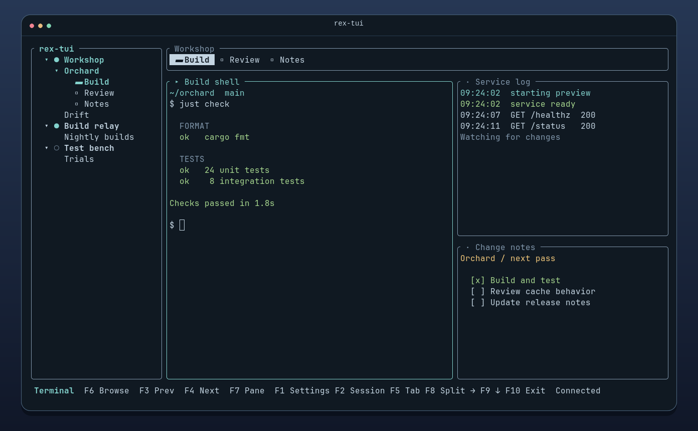
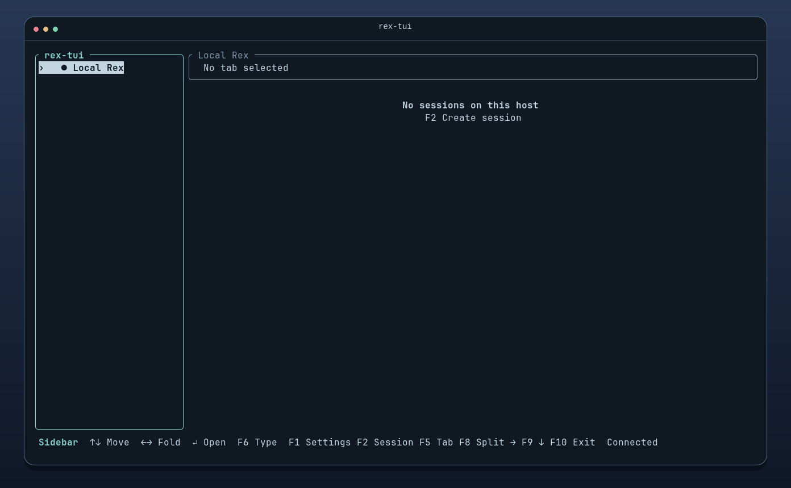

# rex-tui

A keyboard-first terminal workspace for [Rex](https://www.superlogical.com/rex). Browse local and remote sessions, work in split panes, and pick up where you left off from another client. Your shells keep running when you detach.

[Install](#install) · [Quick start](#quick-start) · [User guide](tui/README.md) · [Roadmap](#roadmap) · [Contributing](CONTRIBUTING.md)



A fictional workspace rendered by rex-tui in Foot. [Reproduce the screenshots](tui/README.md#capture-the-demo).

## Install

**Arch Linux and Omarchy (x86_64).** Copy this into your terminal to install the current preview:

```sh
package=rex-tui-0.1.0-16-x86_64.pkg.tar.zst
curl -fLO "https://github.com/andrew-bierman/rex-tui/releases/download/rex-tui-v0.1.0-16/$package" &&
  sudo pacman -U "./$package"
```

The package includes rex-tui and its matching backend. [Browse preview downloads](https://github.com/andrew-bierman/rex-tui/releases). For a source build, follow the [build and install guide](tui/README.md#install-on-arch-linux-and-omarchy).

## Quick start

1. Start your local Rex server or have the remote endpoint ready. The Linux install instructions require a Discord sign-in. [Rex server setup on Linux](https://www.superlogical.com/rex/docs/linux/installation).
2. Run `rex-tui` in Foot or another terminal. It connects to your local Rex server by default. See the [remote hosts and profiles guide](tui/README.md#hosts-and-profiles) for other servers.
3. Press **F2** to create a session on the active host. Use the sidebar arrows and **Enter** to open an existing session or tab.



| Key | Action |
| --- | --- |
| **F6** | Switch between the sidebar and shell input |
| **F3 / F4** | Switch tabs |
| **F5** | Open a shell in a new tab |
| **F8 / F9** | Split the focused pane right or down |
| **Ctrl+Alt+Arrow** | Focus a neighboring pane |
| **F10** | Detach and leave sessions running |

[See all shortcuts](tui/README.md#controls).

## What works now

- **Workspaces.** Browse and fold the host tree, create and rename sessions, open and reorder shell tabs, and confirm before closing a tab or session.
- **Panes.** Split and resize panes with the keyboard, move focus by direction, rename a pane, and scroll its history with **Alt+PageUp / Alt+PageDown**. The client also resizes visible panes it owns when the terminal window changes size.
- **Input and clipboard.** Type and paste into a focused shell. Foot can copy text from its native selection. Opt in to pane selection, click-to-focus, a pane context menu, or the local input composer.
- **Appearance and keys.** Open **F1** to edit or reload settings. Remap shortcuts, position the sidebar, change pane borders and headers, and select a named theme. Chrome and default pane colors follow the terminal palette. [ANSI palette inheritance](tui/README.md#ansi-palette) is opt-in.

A [personal Rex server started over SSH](docs/hosts.md#ssh-setup) runs until stopped or the host restarts. On systemd hosts, logging out ends the server and its sessions unless lingering is enabled.

## Roadmap

The roadmap takes its cues from the official [Rex for Mac actions](https://www.superlogical.com/rex/docs/reference/mac-actions) and [settings](https://www.superlogical.com/rex/docs/reference/mac-settings). Keyboard workflows come first. Changes to the published preview are verified in private Foot against disposable Rex sessions.

| Area | What’s planned |
| --- | --- |
| Navigation | Searchable command palette, global session and tab switcher, sidebar filtering, and recent-tab history |
| Workspace controls | Move, zoom, balance, and close panes, plus close-others and floating panes |
| Scrollback | Search within a pane, prompt jumps, and keyboard copy mode |
| Activity | Tab indicators, work grouped by session or priority, and opt-in desktop notifications |
| Hosts and files | Host management, SSH setup guidance, device pairing, paths, file insertion, and links |
| Mouse | Divider resizing, tab context actions, and forwarding for terminal programs that request it |
| Settings | Theme picking and import, key sequences and modes, and terminal display preferences |

After the keyboard workflows, the roadmap includes a richer input composer and optional terminal preloading.

## Contribute

See the [contribution guide](CONTRIBUTING.md) for reporting bugs, proposing changes, and sharing tested patches. The [Arch package workflow](.github/workflows/tui-package.yml) builds and installs the package in clean CI.

## License and acknowledgments

Built with [Ratatui](https://ratatui.rs/) and forked from [Rex Rune](https://github.com/shuv1337/rex-rune). The [upstream sync guide](tui/README.md#releases-and-upstream-sync) covers shared core updates. The repository also hosts an [alpha Qt Quick client](qt/README.md).

Project code is released under the [MIT License](LICENSE). See the [vendored dependency notes](docs/building.md#vendored-dependencies) and [icon notices](resources/icons/README.md) for licenses and attribution.
