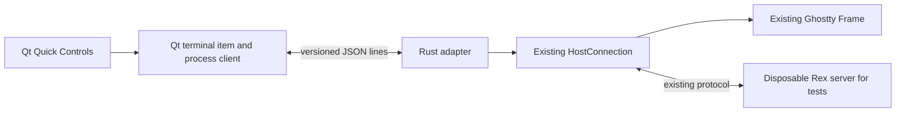

# Qt Quick Terminal Milestone - Plan

## Goal Capsule

Objective: deliver a separate native Qt Quick executable that discovers Rex sessions, tabs and panes and runs one real interactive Ghostty-backed terminal through the existing Rust core.

Execution profile: one feature branch and one reviewable change set; ship to an owned fork only, never the upstream repository. Preserve the original Rune application and locked dependency graph.

## Product Contract

### Summary

Add a standalone Qt Quick Controls frontend and a narrow Rust adapter process. Use the existing connection workers and Ghostty renderer for authoritative state. Verify actual shell interaction, resizing, clipboard and a full-screen editor on a disposable server.

### Problem Frame

The user wants familiar native Qt interaction patterns on Omarchy while retaining Rex Rune's terminal functionality. Rune's workspace views cannot simply be restyled into Qt controls.

### Key Decisions

- Build an alternate frontend rather than reskin Rune (session-settled: user-directed — chosen over a Rune color reskin: native Qt controls and interaction are the requested outcome). Governs R1.
- Reuse the Rust connection and Ghostty terminal core (session-settled: user-directed — chosen over a protocol and VT rewrite: preserve tested Rex behavior). Governs R2.

- Keep an upstream-tracking downstream fork and a thin optional Qt layer (session-settled: user-directed, 2026-11-15). Preserve Rune source/build, reuse public core workers, and isolate any unavoidable core changes into separately documented commits. Prefer a separate crate only when evidence shows less upstream churn; do not build a hypothetical GTK abstraction. Governs R8.

### Requirements

- R1. Provide a separate Qt Quick executable with session, tab and pane selection and a dominant single terminal canvas.
- R2. Reuse core workers, snapshots, terminal frames and ordinary `client.key` input; retain server-owned colors and grid state.
- R3. Render fixed cells, wide/combining text, styles and cursor; support terminal keys, paste and visible text copying.
- R4. Resize only the displayed owned pane, pause input on disconnection and never replay failed input.
- R5. Startup attachment never creates sessions or changes server lifecycle/configuration; use separate frontend preferences or no persisted preferences.
- R6. Prove shell output/input, PTY dimensions, selection and full-screen editor save through the frontend on private fixtures.
- R7. Preserve existing Rune features/build and document limitations, reproducible commands and evidence without private environment data.

- R8. Keep `origin` owned and `upstream` shuv1337/rex-rune distinct; test and document an upstream integration rehearsal, core/Qt gates and conflict hotspots. Audit the final diff for core edits and duplicate backend behavior.

### Scope Boundaries

This milestone displays one selected pane rather than recreating split geometry. Defer full shortcut settings, host management, graphics protocols, full scrollback UX and parity with every Rune dialog. Do not copy Omarchy or Renux code/assets; Renux is read-only reference (Apache-2.0), this repository remains MIT. Qt shared libraries retain their own licensing obligations.

## Planning Contract

### Key Technical Decisions

- KTD1. Use standalone Qt Quick Controls and a custom QQuickPaintedItem. Quickshell hosting would add shell lifecycle dependencies without solving terminal rendering. Qt's public item/control APIs suffice; no consequential competing mechanism needs a bake-off.
- KTD2. Use a private child-process JSON-lines adapter with an explicit protocol version. Keep all transport and VT parsing in Rust and UI/platform behavior in Qt. Deduplicate frame publication, drain both host and terminal wake sources, and terminate the child cleanly on app exit.
- KTD3. Reuse HostConnection with `create=None` and `theme=None`. Tab changes use the server focus API; pane target identity is validated on every input and resize. Selecting/copying never claims size; typing/pasting or foreground interaction may claim the displayed pane, then apply its desired size.
- KTD4. Render each cell at measured fixed advance with kerning/ligatures disabled; skip wide tails and preserve server colors. Qt handles keyboard events and clipboard; ordinary keys use Command::Key, paste uses Command::Paste.

### High-Level Technical Design

### U1. Reusable adapter boundary

**Goal:** expose discovery, selection, safe terminal commands and authoritative frame snapshots without Rune.

**Requirements:** R2, R4, R5.

**Dependencies:** none.

**Files:** `Cargo.toml`, `qt/backend/main.rs`, `qt/backend/adapter.rs`, adapter tests beside the module.

**Approach:** implement the versioned adapter using existing host/terminal models. Validate selected identities, ownership and connection flags; errors stay protocol records and diagnostics stay stderr. Keep implementation independent of Qt and new Cargo dependencies.

**Patterns to follow:** `src/connection.rs`, `src/bin/workspace_probe.rs`, `src/terminal.rs`.

**Test scenarios:** disconnected input is refused; removed/stale targets cannot receive input; resizing an unowned or hidden pane emits no command; emitted frames retain wide tails/colors; no startup creation command.

**Verification:** locked no-default-features adapter build and state tests pass.

### U2. Native Qt frontend

**Goal:** deliver real cell rendering and keyboard interaction in a separate executable.

**Requirements:** R1, R3, R4, R5.

**Dependencies:** U1 protocol contract.

**Files:** `qt/` application, QML, qmake project and build instructions, Qt verification source as needed.

**Approach:** Qt Quick Controls provide session/tab/pane selectors and exception state; a custom terminal item paints frames and forwards captured keys, geometry and clipboard actions. Use QProcess to own the adapter. No persisted user config is needed initially. Do not implement ordinary terminal keys as application shortcuts or allow Tab traversal to consume them.

**Test scenarios:** CJK and combining characters keep fixed columns; Ctrl/Alt/navigation/press/release reach client.key; paste and copy use Qt clipboard; resizing only applies to owned visible target; process failure visibly pauses input.

**Verification:** build via installed qmake6, run rendered private fixture; record keyboard and editor evidence, not a mockup.

### U3. Private end-to-end verification and handoff

**Goal:** prove the milestone and retain repeatable evidence.

**Requirements:** R6, R7.

**Dependencies:** U1, U2.

**Files:** `scripts/qt-private.py`, `docs/qt-quick-milestone.md`, scoped README addition.

**Approach:** reuse private-server patterns in existing scripts; create multiple sessions/windows/panes there, launch Qt in private display where possible, drive actual Qt input, observe output/resize and save a known editor file. Capture only private fixtures. Record limitations and cleanup only owned processes/resources.

**Test scenarios:** discovery and switching; shell command produces unique output; editor uses alternate screen and saves expected bytes; resize matches PTY; clipboard round trip; disconnect retains screen but refuses further input.

**Verification:** end-to-end script passes, original locked build/tests/fmt/clippy run as environment permits with exact failures recorded.

### Risks and Dependencies

Qt 6.12 base/declarative and qmake6 are installed; cmake and Rust were absent from PATH. Rust is provisioned independently under `/tmp` for verification. Existing Zig 0.17.0 is available. Native Wayland permission and toolchain/dependency access are execution-time checks. JSON frames add serialization cost; retain bounded update cadence rather than claiming production renderer performance.

### Verification Contract

Require real private-server interaction through Qt, not CLI input substituted for frontend proof. Run `cargo test --locked --no-default-features`, original `cargo build --locked --release --bin rex-rune`, all-feature tests, fmt and clippy where available. Test new bridge state behavior and terminal keys. Verify the rendered Qt window at normal and minimum sizes. Missing mandatory runtime proof is an explicit blocker, never success.

### Definition of Done

All requirements have evidence; original frontend remains buildable; no abandoned prototype code remains; limitations and commands are durable; reviewed changes are locally committed and shipped only to an owned fork if auth permits. Never merge.

### Sources

- `src/lib.rs`, `src/connection.rs`, `src/terminal.rs`, `src/app/keys.rs`: core boundary and frontend obligations.
- `PRODUCT.md`, `DESIGN.md`, `AGENTS.md`: attachment, input, ownership and UI constraints.
- [Qt QQuickPaintedItem](https://doc.qt.io/qt-6/qquickpainteditem.html), [Qt Quick Controls](https://doc.qt.io/qt-6/qtquickcontrols-index.html): public rendering/control APIs.
