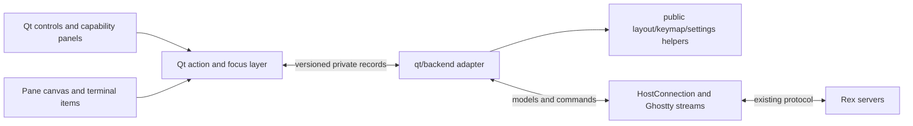
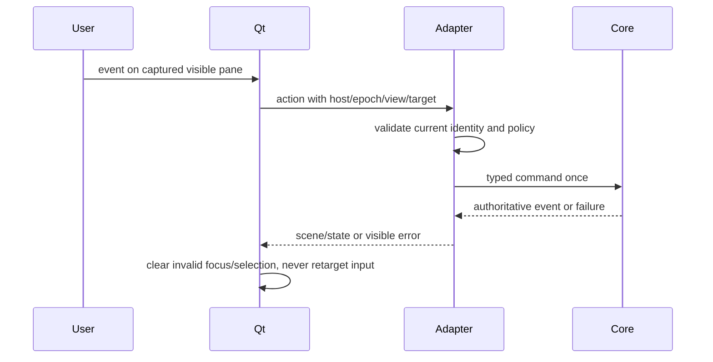
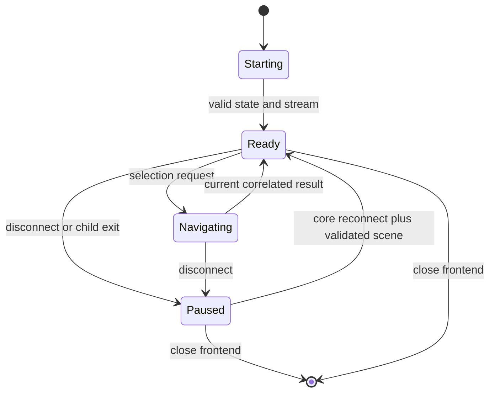
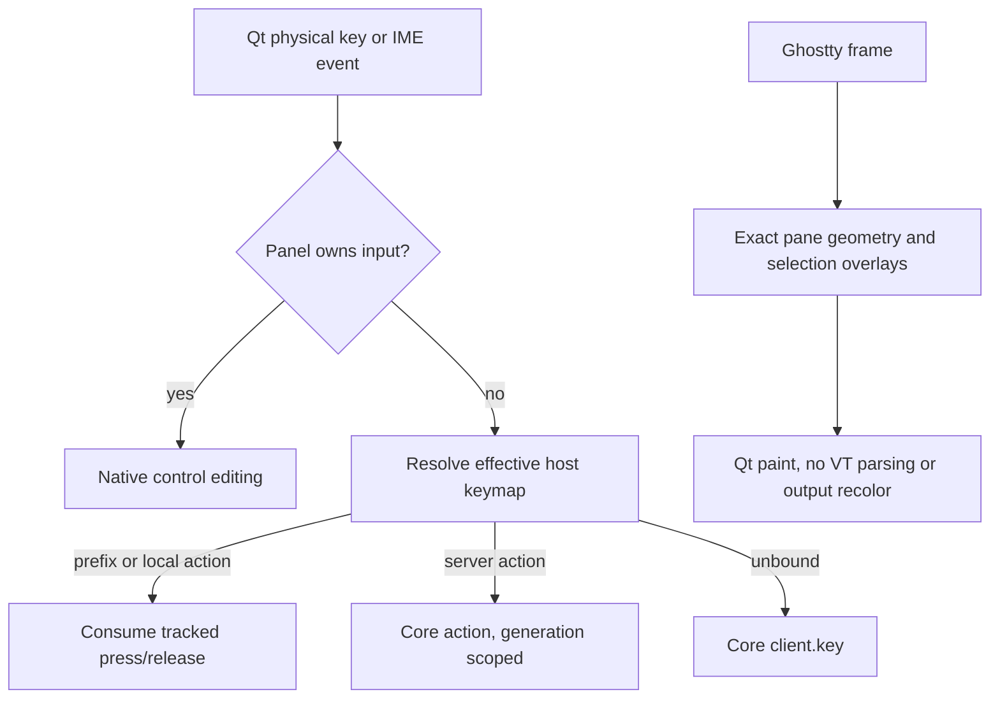

# Qt Feature Parity - Plan

## Goal Capsule

**Objective:** daily Rex work on Linux can be done in the Qt frontend with the implemented capabilities of the Rune source-build client, without returning to Rune for missing workspace or terminal operations.

**Means:** extend the existing standalone Qt Quick frontend and its private Rust adapter through public Rex Rune APIs (KTD1–KTD4).

**Authority:** the requirements below govern behavior; PRODUCT.md and DESIGN.md supply the existing safety and interaction contracts. Native Qt controls supply presentation rather than reproducing Rune widgets. This is a new work source after the completed first milestone, not a rewrite of its evidence.

**Execution profile:** one downstream change set, delivered through the owned fork after implementation, simplification, review and verification. Finish the active units in dependency order; an intermediate usable checkpoint does not mean full parity. Do not merge. A proven public-core limitation is a named blocker or a narrow separately committed upstream-source fix, not permission to build another protocol engine.

**Stop conditions:** inability to verify a required capability, an invalidated settled architecture choice, or a required action outside the authorized private fixtures. Preserve all partial work and record the exact remaining matrix rows.

---

## Product Contract

### Summary

Complete Linux source-build feature parity using Qt Quick controls and the existing Rust connection, layout and Ghostty core. Deliver authoritative multi-pane terminals first, then the shared action/keymap surface, lifecycle controls, saved hosts, settings and advanced capabilities. Retain a checked capability matrix so a partial checkpoint cannot be described as parity.

### Problem Frame

The first milestone proves a real interactive terminal but displays only one pane and omits routine navigation, scrollback, mouse, settings and workspace management. Those omissions prevent the Qt client from replacing Rune for daily coding across several machines.

### Key Decisions

- **Keep Qt a thin additive downstream frontend** (session-settled: user-directed — chosen over a forked backend or broad core/frontend rewrite: upstream improvements must remain importable). Governs R1, R2.
- **Use native Qt interactions rather than a Rune color reskin** (session-settled: user-directed — chosen over restyling existing Rune widgets: consistent Qt controls are the requested experience). Governs R3, R8.
- **Preserve installed apps and existing server work** (session-settled: user-directed — chosen over replacing installed clients or testing in working sessions: other people and agents are active). Governs R2, R15.

### Requirements

#### Architecture and safety

- R1. Preserve the existing Rune executable and locked dependencies; downstream implementation belongs under `qt/`, supporting scripts and Qt documentation, with additive build integration. A proven public-core limitation permits only a narrow, separately committed and documented upstream-source fix; no such fix is currently a prerequisite.
- R2. Keep ordinary attachment/reconnect free of server lifecycle or session creation/destruction, never replay failed input, and preserve complete host/session/tab/pane identity through asynchronous actions.
- R3. Match implemented Linux source-build capabilities and interaction outcomes, using Qt controls; a feature is complete only when its corresponding matrix row has runtime or state evidence.

#### Daily terminal and workspace

- R4. Display every visible server-authoritative pane and divider, including nested splits, floating layers, zoom and minimized-layer behavior; pane focus, geometry and size ownership follow the existing contracts.
- R5. Support scrollback, screen/scrollback search, prompt navigation, tracked word/line/drag selection with autoscroll, terminal mouse/wheel reporting, Shift override, clipboard policies and focused-pane OSC 52 copies without reads.
- R6. Preserve fixed-cell text, server colors, cursor/decorations, device-pixel box drawing, static supported graphics, synchronized output, physical-layout key semantics, dead keys and IME.
- R7. Provide explicit session/tab/pane creation, rename, split, resize, balance, move, swap, zoom, directional focus, tab reorder/mute/close-others and destructive confirmations defaulting to Keep running.
- R8. Provide removable/rebindable layered workspace shortcuts, modes/sequences, Commands, shortcut recording and hints from one effective action/keymap model; unconsumed keys retain `client.key` semantics and paired releases.
- R9. Provide saved Unix/HTTPS/WSS/SSH hosts, tailnet discovery, scalable sidebar/switcher navigation, history and contextual window titles with isolated per-host consent and state.
- R10. Persist Qt-owned settings separately from Rune, including terminal typography/fallbacks/theme declaration, selection/cursor policy, interface layout and density, padding, zoom, headers, outlines, tab sizing/icons/color, toolbar visibility, palette and fullscreen; include settings search/history and safe reset behavior.

#### Advanced capabilities

- R11. Present activity/status/progress/bells, program icons, grouped Activity, ages/chip, session words and unopened-session coverage; provide notification health/testing, tab mute and default-off local sounds with existing eligibility semantics.
- R12. Provide Insert path, Go to directory and recent paths; upload file drop/paste where supported; provide download confirmation/progress/cancel/cleanup and Show in folder only, with no overwrite/open/run behavior.
- R13. Implement the existing declared client-action compatibility and default-off per-host remote-control allowlist with epoch-scoped replies, modal/typing constraints and per-request notices.
- R14. Provide cached server facts/duration, explicitly confirmed one-shot server controls, local Pair device QR, safe version/debug info, local integration previews/setup and source-build update checks/guidance.
- R15. Verify all new behavior on disposable private fixtures, retain concise durable evidence and honest unsupported platform/installation distinctions, and ship only to the owned fork without merging.

### Parity matrix at planning baseline

The baseline is README.md Capabilities plus PRODUCT.md/DESIGN.md at the current checkout. “Missing” and “partial” describe Qt before this plan; they do not defer active work. “Inherited” means core behavior exists but still needs frontend verification. Full Kitty graphics and terminal screen-reader support are outside Rune's own implemented baseline.

| Capability | Qt baseline | Active unit | Authoritative implementation reference |
| --- | --- | --- | --- |
| Snapshot/live output/reconnect/no replay | Present, private runtime verified | U1, U15 preserve | `src/connection.rs`, `docs/qt-quick-status.md` |
| Session/tab/pane discovery and selection | Present for one displayed pane | U1, U5 | `qt/backend/adapter.rs`, `src/connection.rs` |
| Nested/tiled/floating splits, dividers, zoom, ownership | Missing multi-pane canvas | U1 | `src/layout.rs`, `src/app/panes.rs`, `src/app/splits.rs` |
| Scrollback/search/prompt navigation | Missing frontend | U2 | `src/terminal/search.rs`, `src/app/find.rs` |
| Tracked selection, autoscroll, word/line, Shift override | Visible-cell drag only | U2 | `src/terminal/selection.rs`, `src/app/term.rs` |
| Mouse/wheel reporting and pointer coordinates | Missing | U2 | `src/app/term.rs`, `src/connection.rs` |
| Clipboard/PRIMARY/copy-on-selection/OSC 52 | Toolbar clipboard only | U2, U6 | `src/connection/clipboard.rs`, `src/app/select_copy.rs` |
| Text/style/cursor/box drawing/graphics/IME | Partial; composition/layout gaps | U14 | `src/terminal.rs`, `src/app/sprites.rs`, `src/app/keys.rs` |
| Links and prompt-aware navigation | Missing | U2, U14 | `src/links.rs`, `src/app/term.rs` |
| Commands, effective shortcuts, modes/sequences/recorder | Missing | U3 | `src/keymap.rs`, `src/app/commands.rs`, `src/app/input.rs` |
| Session/tab/pane lifecycle and arrangement | Missing | U4 | `src/app/tabs.rs`, `src/app/splits.rs`, `src/app/pane_verbs.rs` |
| Saved hosts, tailnet/listeners, SSH setup | Endpoint CLI only, core transport inherited | U5, U12 | `src/tailnet.rs`, `src/ssh.rs`, `src/app/discover.rs` |
| Sidebar, searchable switchers, history, titles | ComboBoxes only | U5 | `src/app/sidebar.rs`, `src/app/panel.rs`, `src/connection/titles.rs` |
| Settings search/history and separate persistence | Missing | U6 | `src/settings.rs`, `src/app/settings_view.rs` |
| Fonts/fallbacks/size/live metrics/server terminal themes | Fixed font, server colors preserved | U6 | `src/settings/typography.rs`, `src/terminal_theme.rs`, `src/app/fonts.rs` |
| Padding/density/headers/outline/fading/tabs/icons/palette/fullscreen | Missing | U6, U7 | `src/settings/interface.rs`, `src/app/theme.rs` |
| Activity words/progress/bells/list/chip/ages/unopened sessions | Core cached, not exposed | U7 | `src/connection/activity/`, `src/app/activity_list.rs` |
| Desktop notifications/health/test/sounds/tab mute | Missing | U8 | `src/app/notify.rs`, `src/app/sounds.rs` |
| Paths/recent paths/directory browser | Missing | U9 | `src/connection/directory.rs`, `src/settings/recent_paths.rs` |
| File upload via drop/paste | Missing | U9 | `src/upload.rs`, `HostCommand::Upload` |
| Download dialog/progress/confirm/cancel/folder | Missing | U10 | `src/connection/downloads.rs`, `src/download/` |
| Client actions and consent-scoped remote control | Missing declarations, denied in practice | U11 | `src/connection/perform.rs`, `src/app/actions.rs` |
| Server facts/control/Pair QR/debug information | Missing | U12 | `src/connection/server_info.rs`, `src/qr.rs`, `src/app/server_page.rs` |
| Local agent integrations and signed update guidance | Missing | U13 | `src/app/integrations.rs`, `src/update/`, `src/app/updates.rs` |
| Source installation self-update/pacman root helper | Not applicable to Qt source build | U13 documents | `PRODUCT.md`, `docs/qt-upstream-maintenance.md` |
| macOS titlebar/Option/notifications and Windows frontend | Outside this Linux parity target | Not active | `src/app/platform/`, README Platform support |
| Native Wayland keyboard/IME/desktop clipboard/accessibility chrome | Startup/keys smoke only | U14, U15 | `qt/test_driver.cpp`, `scripts/qt-private.py` |

### Acceptance examples

- AE1. Covers R4: three nested panes plus a floating pane render at public layout placements; zoom hides neighbors, and a second client's ownership prevents resize until this window comes forward or receives input.
- AE2. Covers R5, R6: after enough colored/CJK output to scroll, search selects an older match, drag selects wrapped text through scrollback, and a mouse-reporting editor receives exact pane-relative coordinates while Shift selects locally.
- AE3. Covers R2, R7: a close dialog captures its original pane; if another client removes it before confirmation, nothing else is closed and no input is retargeted.
- AE4. Covers R8: rebinding/removing a local shortcut updates dispatch, Commands and hints together; a consumed prefix and its release never leak into the PTY.
- AE5. Covers R9, R13: two hosts can contain identical labels; navigation, settings and remote requests act only on the captured host and current epoch.
- AE6. Covers R12: canceling a large download removes its private partial file; completion offers Show in folder but never Open or execution, and a duplicate destination is never overwritten.
- AE7. Covers R15: a clean worktree builds both frontends and passes private shell/editor/resize/clipboard tests without touching the already-open demo or personal server.

### Scope boundaries

This is parity with the implemented Linux source-build client, not complete official Rex/Mac parity. Moving an existing pane to a newly created tab remains unsupported because the baseline API cannot perform that operation; moving to an existing tab is active work. Qt presentation may use familiar native controls instead of Rune-specific glass effects. Do not import Rune app views or copy its workspace engine. Existing licensed fonts/program icons may be referenced with their notices intact; no Omarchy/Quickshell/Renux code or moving private shell internals are introduced.

Considered and not built: a generic cross-toolkit UI framework, a new protocol/VT engine, a backend network service, automatic migration of Rune settings, and a Qt package/root updater. None is needed for the requested source-build capability baseline. A future installation channel would need its own eligibility/signature review before enabling in-app installation.

### Deferred to Follow-Up Work

macOS and Windows Qt releases, complete Kitty graphics, terminal screen-reader semantics and distribution packages remain outside the Linux baseline. No Linux baseline matrix row is deferred merely because it occurs late in the unit order.

---

## Planning Contract

### Assumptions

“Feature parity” means the current implemented Linux source-build capabilities, not every feature in official Rex clients. Native Qt interaction patterns take precedence over pixel-identical Rune chrome. The existing local demo stays open and untouched while verification runs separate owned fixtures. A single branch/PR can carry sequential commits and usable checkpoints; completion still requires every active unit.

### Key Technical Decisions

- KTD1. Keep the Rust adapter private under `qt/backend/` and consume only public `rex_rune` APIs (session-settled: user-directed — chosen over editing/copying upstream connection and VT internals: preserve the downstream import boundary). Implements R1. No new Cargo dependency or lockfile change is currently required.
- KTD2. Evolve the existing versioned child-process protocol to carry a scene of visible pane frames and exact targets. Publish layout and frames with host connection/selection generations, drain per-pane wakes and deduplicate/throttle publication. Reject stale events at the adapter before dispatch; do not add another reconnection engine.
- KTD3. Use `layout::placements(window, None)` and public divider/neighbour/resize/balance helpers. Qt transforms normalized coordinates into its viewport without inventing split ratios. Input targets the focused visible pane; geometry/resize may name any visible owned pane. Foreground claims include visible panes only.
- KTD4. Route terminal interactions through public `Command` variants and host mutations through public `HostCommand` variants. Reuse `keymap::resolve_all` and core declaration/snapshot types; a Qt-owned action registry supplies presentation and local dispatch. Do not expose unrestricted generic RPC to QML or remote callers.
- KTD5. Use a Qt-specific config path and app identity. Reuse public settings value types where useful, but never call the default Rune load/migration path. Keep persisted host identity and recorded shortcut sources distinct; save atomically and never rewrite a user-owned shortcut file.
- KTD6. Keep QtTest's separate event-driver target as the end-to-end seam, with private Rex fixtures and injected native Qt events. Add private X11/Wayland checks only where platform integration matters; fixture services/players/helpers replace desktop side effects.
- KTD7. Extend Qt frontend modules by capability rather than reproducing one large Workspace class. Public core models own transport/session/terminal state; Qt owns panels, focus, actions, local navigation/settings and native services. Existing `Frontend` remains the Qt/QProcess facade, with bounded helper modules.

### Existing behavior trace

`HostConnection` owns the control connection, current session views and all terminal streams of the active server window. Public `layout::placements` provides normalized panes/dividers, preserving minimized and zoomed-layer rules. Each `Connection` owns a frame/model and its own wake channel. The current adapter selects one connection and serializes one frame; removing that presentation restriction does not require changing the core stream engine.

Public Frame currently lacks scrollback length/viewport offset and alternate-screen state. Match Rune's existing mouse_tracking-versus-Scroll policy; an accurate proportional scrollbar or new alternate-screen policy is not an additional parity requirement. Core terminal input checks connection state and claims on non-passive input. Resize itself does not enforce ownership, so the adapter must validate visible target plus owner. Search, scrolling and tracked selection are local commands on that same terminal stream. Navigation and server mutations are asynchronous; replies/events may invalidate the UI's original target. Disconnect retains frames and drops input rather than replaying it. These constraints remain in force for every new Qt surface.

### High-Level Technical Design

Component ownership:

Event ordering and identity:

Lifecycle:

Data flow and local key dispatch:

### Risks and dependencies

Public Rust APIs are not a stable downstream ABI; the maintenance gate in `docs/qt-upstream-maintenance.md` remains required. Many Rune frontend policies are private app code, so Qt must implement their UI policy while reusing public core mechanics; that is frontend work, not permission to duplicate transport.

JSON frames/QPainter currently have no large-grid benchmark. Multi-pane publication must avoid serializing unchanged frames on every unrelated wake; U15 measures representative split grids and records limits before claiming daily readiness. Font fallback, IME, desktop clipboard and accessibility need native checks in addition to offscreen events. No Xvfb or nested compositor is currently installed; U14 must provision an isolated display for desktop clipboard proof or report that row unverified. Never mutate the personal clipboard or global keyboard/layout configuration.

The owned fork's Actions registration was previously absent despite workflow files. Local validation is the development gate; CI is optional delivery evidence and must not be fabricated or allowed to block implementation. Notifications, sound, integration setup and opener tests use private/fake services. Package installers, privileged containers and the real pacman helper are never exercised. Exact future module names are implementation details; unit ownership and public-core boundaries are fixed.

---

## Implementation Units

| Unit | Outcome | Primary paths | Depends on |
| --- | --- | --- | --- |
| U1 | Authoritative multi-pane scene | `qt/backend/adapter.rs`, `qt/Main.qml`, `qt/frontend.*` | Existing milestone |
| U2 | Scroll/search/selection/mouse | `qt/terminal.*`, `qt/backend/terminal.rs` | U1 |
| U3 | Shared actions and layered shortcuts | `qt/actions.*`, `qt/backend/keymap.rs` | U1 |
| U4 | Workspace lifecycle and arrangement | `qt/WorkspaceActions.qml`, `qt/backend/workspace.rs` | U1, U3 |
| U5 | Saved hosts and scalable navigation | `qt/hosts.*`, `qt/backend/hosts.rs`, `qt/Sidebar.qml` | U3, U4 |
| U6 | Settings, typography and interface | `qt/settings.*`, `qt/Settings.qml` | U2, U3, U5 |
| U7 | Activity and program presentation | `qt/activity.*`, `qt/backend/activity.rs` | U1, U5, U6 |
| U8 | Notifications and sounds | `qt/notifications.*`, `qt/sounds.*` | U6, U7 |
| U9 | Directory paths and uploads | `qt/Directory.qml`, `qt/backend/files.rs` | U4, U5, U6 |
| U10 | Downloads | `qt/Downloads.qml`, `qt/backend/files.rs` | U5, U6, U9 |
| U11 | Client-action and remote-control parity | `qt/backend/remote.rs`, `qt/actions.*` | U3, U5, U6 |
| U12 | Server facts, setup and pairing | `qt/ServerSettings.qml`, `qt/backend/server.rs` | U5, U6 |
| U13 | Integrations, updates and About | `qt/Integrations.qml`, `qt/About.qml`, `qt/backend/maintenance.rs` | U6, U12 |
| U14 | Rendering/input/native parity gaps | `qt/terminal.*`, `qt/platform.*` | U2, U6 |
| U15 | Complete parity verification and delivery | `scripts/qt-private.py`, `docs/qt-parity.md` | U1–U14 |

### U1. Render authoritative multi-pane scenes

**Goal:** replace the single-pane presentation restriction with the actual visible server layout.

**Requirements:** R1, R2, R4; KTD1–KTD3.

**Dependencies:** existing milestone.

**Files:** `qt/backend/adapter.rs`, new adapter tests in `qt/backend/tests.rs`, `qt/frontend.h`, `qt/frontend.cpp`, `qt/Main.qml`, `qt/terminal.h`, `qt/terminal.cpp`, `qt/test_driver.cpp`, `docs/qt-backend-protocol.md`.

**Approach:** serialize public placements/dividers plus per-pane frames, connection state and captured targets. Follow authoritative focused_block_id after a pending click-focus acknowledgment; remove the current permanent Adapter.pane override. QML instantiates terminal items in layer order. Separate focused input validation from visible-owned resize validation. Clear removed targets and keep retained disconnected frames. Keep the production child/UI protocol coordinated by an explicit version bump or compatible additions.

**Patterns to follow:** `src/layout.rs`, `src/app/panes.rs`, existing adapter target/navigation tests.

**Test scenarios:**
- Nested split and floating placements match core rectangles, including zoom and minimized layers.
- Background pane output updates without a host wake; stable per-pane revisions and existing snapshot dedup avoid unnecessary Qt item work. A new delta protocol is not required.
- A visible unselected pane resizes only when owned; hidden/removed panes never receive resize or claim.
- A navigation completion or disconnect invalidates pending old-pane input without replay.

**Verification:** adapter scene tests and Qt event-driver private two-pane editor/shell acceptance pass at normal/minimum sizes. The state seam proves targets/rectangles; rendered acceptance proves hit-testing and cells.

### U2. Add terminal navigation, tracked selection and mouse

**Goal:** make terminal history and interactive programs usable through pointer and search interactions.

**Requirements:** R2, R5; KTD3, KTD4, KTD6.

**Dependencies:** U1.

**Files:** new `qt/backend/terminal.rs`, `qt/terminal.h`, `qt/terminal.cpp`, new `qt/FindBar.qml`, `qt/frontend.*`, `qt/test_driver.cpp`, `scripts/qt-private.py`, `qt/backend/tests.rs`.

**Approach:** expose public Scroll/Search/SearchStep/PromptStep/Selection/Mouse/Wheel commands and frame search/selection metadata. Use core tracked selection generations/revisions rather than Qt visible-cell indexing. Route mouse reporting according to frame mode, with Shift local selection override; wheel history and program wheel behavior follow Rune. Add prompt navigation and search focus/cancel behavior. Native clipboard/PRIMARY and OSC 52 use captured focused target, visibility and connection epoch; clipboard reads are never answered.

**Patterns to follow:** `src/terminal/selection.rs`, `src/terminal/search.rs`, `src/app/term.rs`, `src/app/find.rs`, `src/app/select_copy.rs`.

**Test scenarios:**
- Search finds screen and older scrollback matches, navigates both ways and clears on cancel.
- Word/line/drag/autoscroll selection copies exact wide/combining/wrapped text after output and viewport movement.
- Raw mouse fixture receives exact local cells/modifiers and wheel deltas in nested panes; Shift selects without reporting.
- Copy/PRIMARY policies respect opt-in and release cancellation; hidden/stale OSC 52 cannot change the clipboard.

**Verification:** private terminal recordings and clipboard assertions use real Qt events; no CLI input substitutes for tested frontend behavior.

### U3. Establish actions, Commands and effective keymaps

**Goal:** give every user-facing operation one action identity and one effective shortcut source.

**Requirements:** R1, R2, R8; KTD1, KTD4, KTD5.

**Dependencies:** U1.

**Files:** new `qt/actions.h`, `qt/actions.cpp`, `qt/backend/keymap.rs`, `qt/Commands.qml`, `qt/ShortcutSettings.qml`, `qt/frontend.*`, `qt/terminal.cpp`, `qt/test_driver.cpp`, `qt/backend/tests.rs`.

**Approach:** adapt public keymap defaults/overrides/resolution and HostCommand::Keymap/Action snapshots. Build a bounded Qt action registry with labels, argument validation, availability and remote decision. Dispatch local and queued known client actions once; preserve server Lua handling for unconsumed keys. Implement modes/sequences, cancel semantics, effective keycaps and recorded shortcut overlays without modifying user-owned files.

**Patterns to follow:** `src/keymap.rs`, `src/connection/keymap.rs`, `src/app/actions.rs`, `src/app/input.rs`, `src/app/wiring_tests.rs`.

**Test scenarios:**
- Rebind/remove/conflict/source precedence changes dispatch, hints and Commands together.
- Prefix press/release and canceled sequences never leak; unbound and released terminal keys remain paired correctly across focus changes.
- Server action success/failure is delivered once, including timed-out or superseded generations.
- Offline defaults and panel editing do not depend on a live host.

**Verification:** registry completeness/keymap tests and raw PTY payload assertions pass before lifecycle shortcuts are added.

### U4. Implement explicit workspace lifecycle and arrangement

**Goal:** create and manage sessions, tabs and panes through native Qt actions.

**Requirements:** R2, R7, R8; KTD3, KTD4.

**Dependencies:** U1, U3.

**Files:** new `qt/backend/workspace.rs`, `qt/WorkspaceActions.qml`, `qt/ConfirmDialog.qml`, `qt/PaneHeader.qml`, `qt/actions.*`, `qt/backend/tests.rs`, `qt/test_driver.cpp`, `scripts/qt-private.py`.

**Approach:** map existing app action semantics to typed host commands and scoped requests, including cwd-inheriting NewTerminal, all split directions/best-fit, public neighbor/resize/balance helpers, pane move/swap/zoom, tab reorder/mute/close-others and rename default titles. Dialogs capture target identity and consequences; default cancellation does nothing. Do not open a hidden alternative session automatically to mask a failed mutation.

**Patterns to follow:** `src/app/tabs.rs`, `src/app/splits.rs`, `src/app/pane_verbs.rs`, `src/app/pane_header.rs`.

**Test scenarios:**
- Creation occurs only after explicit actions and inherits the source directory where available.
- Confirmed close targets the captured pane/tab/session; disappearance or host switch prevents retargeting.
- Split ratios, balance, swap, move-to-tab and directional focus follow server events exactly.
- Rename/mute/reorder/close-others update the intended host only; cancel leaves programs running.

**Verification:** disposable sessions show expected layouts and process survival through each cancel/confirm path.

### U5. Add saved hosts, sidebar and navigation history

**Goal:** navigate daily work across multiple host/session/tab inventories without label ambiguity.

**Requirements:** R1, R2, R9; KTD4, KTD5.

**Dependencies:** U3, U4.

**Files:** new `qt/hosts.h`, `qt/hosts.cpp`, `qt/backend/hosts.rs`, `qt/Sidebar.qml`, `qt/Switcher.qml`, `qt/HostDialog.qml`, `qt/frontend.*`, `qt/backend/tests.rs`, `scripts/qt-private.py`.

**Approach:** supervise one existing-core HostConnection per saved host and expose explicit host IDs. Reuse public endpoint validation, SSH transport and tailnet probes; all connections remain attachment-only. Add optional sidebar, searchable switchers, server-order tab navigation, history and title resolution. Keep background activity views distinct from opened sessions. Store no user endpoint in public evidence.

**Patterns to follow:** `src/settings.rs`, `src/tailnet.rs`, `src/ssh.rs`, `src/connection/titles.rs`, `src/app/sidebar.rs`, `src/app/workspace.rs` navigation behavior.

**Test scenarios:**
- Two private servers with duplicate labels keep focus/history/commands isolated by IDs.
- Add/edit/remove host persists separate Qt settings and cleans only that host's local history/state.
- Unreachable, SSH-missing and unsupported API states are visible without auto-start or creation.
- Many sessions/tabs and 640×480 navigation remain keyboard-accessible; history restores exact targets.

**Verification:** private multi-host navigation and config round-trip pass; no Rune config file is read or changed.

### U6. Build Qt settings, typography and interface controls

**Goal:** expose existing local preferences through consistent native Qt controls.

**Requirements:** R3, R8, R10; KTD5, KTD7.

**Dependencies:** U2, U3, U5.

**Files:** new `qt/settings.h`, `qt/settings.cpp`, `qt/backend/preferences.rs`, `qt/Settings.qml`, `qt/TerminalSettings.qml`, `qt/InterfaceSettings.qml`, `qt/FontPicker.qml`, `qt/rex-qt.pro`, `qt/test_driver.cpp`, `qt/backend/tests.rs`.

**Approach:** implement a separate Qt settings schema/path using public setting types/defaults where practical. Add searchable pages/history, ordered installed/bundled fallbacks, primary/font style/live metrics/spacing/line height, cursor/selection previews, server-declared themes including Ghostty files, chrome palettes, interface zoom/density/padding/headers/outline/fading, tab fill/icon count/color, toolbar visibility and fullscreen. Follow default semantics documented by upstream; controls update only local state except explicit core theme/owned resize declarations.

**Patterns to follow:** `src/settings/`, `src/terminal_theme.rs`, `src/app/terminal_page.rs`, `src/app/font_page.rs`, `src/app/settings_view.rs`; Qt controls replace Rune kit widgets.

**Test scenarios:**
- Defaults and save/reload preserve independent Qt state without changing Rune preferences or user shortcut files.
- Font/padding changes keep preview, hit-testing, cursor, selection and owned PTY sizes on the same metrics.
- Theme declarations obey core ownership and Follow server clears a previous declaration correctly.
- All settings are searchable, controls remain reachable at minimum size, and reset/cancel preserve safety defaults.

**Verification:** settings round-trip tests plus individual real-font captures and live private PTY mouse/resize checks pass.

### U7. Add activity, icons and session status presentation

**Goal:** surface actionable work across opened and unopened sessions.

**Requirements:** R9, R11; KTD1, KTD5.

**Dependencies:** U1, U5, U6.

**Files:** new `qt/backend/activity.rs`, `qt/activity.h`, `qt/activity.cpp`, `qt/Activity.qml`, `qt/ProgramIcon.qml`, `qt/Sidebar.qml`, `qt/PaneHeader.qml`, `qt/backend/tests.rs`, `scripts/qt-private.py`.

**Approach:** project public cached activity/status/progress/bell records into grouped inventories and shared tab/session words. Reuse core status sweep and monotonic age data; do not poll every pane or attach background sessions as open. Match existing program mapping using licensed catalog/assets without changing generated resources. Add priority/session views, filters, stable selection, folded-tab elapsed labels and chip visibility.

**Patterns to follow:** `src/connection/activity/`, `src/connection/status_sweep.rs`, `src/app/activity_list.rs`, `src/app/tab_icons.rs`, `src/app/program_icons.rs`.

**Test scenarios:**
- Unopened-session needs-input/error reports appear without opening their tabs.
- Filtering/reordering/live wakes preserve selected target; seeing a tab clears only its local unseen state.
- Muted tabs suppress eligibility while program progress and labels remain correctly scoped.
- Program icons/count/color and ages are consistent across tabs, headers, sidebar and Activity.

**Verification:** private status fixtures, age assertions and captures match the upstream semantic examples.

### U8. Implement desktop notifications and default-off sounds

**Goal:** notify about eligible unseen activity without duplicates or desktop side effects in tests.

**Requirements:** R11; KTD5, KTD7.

**Dependencies:** U6, U7.

**Files:** new `qt/notifications.h`, `qt/notifications.cpp`, `qt/sounds.h`, `qt/sounds.cpp`, `qt/NotificationSettings.qml`, `qt/rex-qt.pro`, `scripts/qt-notifications-private.py`, `qt/test_driver.cpp`.

**Approach:** implement Linux native services behind a Qt platform interface, consuming shared Qt activity eligibility. Mirror per-tab replace/close, service health/test, program notices, focus/navigation and recovery semantics. Sounds remain default-off, severity-coalesced and worker-only with bounded spawn/reap; no real audio is used during tests. Use Qt DBus if available as a qmake-only dependency; no Cargo graph change is needed.

**Patterns to follow:** `src/app/notify/worker.rs`, `src/app/notification_tests.rs`, `src/app/sounds/player.rs`, existing private notification/sound scripts.

**Test scenarios:**
- Fake private notification bus records one replace/close per tab and correct destination on activation.
- Unavailable/rejected service produces searchable health and an immediate failed test result.
- Mute/seen/default-off states suppress expected sounds; fake player timeout/recovery never blocks UI.

**Verification:** private bus and fake-player acceptance passes with zero personal desktop notifications/audio.

### U9. Add path browsing, recent paths and file uploads

**Goal:** move paths/files into the correct remote terminal without executing commands.

**Requirements:** R2, R12; KTD4, KTD5.

**Dependencies:** U4, U5, U6.

**Files:** new `qt/backend/files.rs`, `qt/Directory.qml`, `qt/UploadStatus.qml`, `qt/terminal.*`, `qt/backend/tests.rs`, `scripts/qt-files-private.py`.

**Approach:** reuse public ListDir, upload File and HostCommand::Upload; mirror captured directory target, cancellation/coalescing, sorting, POSIX quoting and recent-path policy. Go to directory pastes `cd` and a quoted directory without Enter. File URLs dropped/pasted upload only for supported API revisions and captured visible targets.

**Patterns to follow:** `src/connection/directory.rs`, `src/upload.rs`, `src/settings/recent_paths.rs`, `src/app/directory.rs`.

**Test scenarios:**
- Quotes/spaces/untrusted filenames produce exact paste-only insertion and no shell execution.
- A host/epoch/target change cancels pending directory/upload UI rather than inserting into another pane.
- Recent paths are endpoint-scoped, bounded and erased when disabled or host identity changes.
- API 10 refuses uploads visibly; private API 11+ upload transfers exact bytes and types returned paths once.

**Verification:** private file fixtures and PTY bytes establish path safety and upload behavior.

### U10. Add safe download workflow

**Goal:** download remote files through the existing safe core with native Qt progress and confirmation.

**Requirements:** R12; KTD4, KTD5.

**Dependencies:** U5, U6, U9.

**Files:** `qt/backend/files.rs`, new `qt/Downloads.qml`, `qt/DownloadDialog.qml`, `qt/frontend.*`, `qt/backend/tests.rs`, `scripts/qt-files-private.py`.

**Approach:** reuse public download requests/state/store behavior. Add person-only path dialog, large/free-space confirmation, toolbar progress/list, cancel, destination setting and Show in folder. App exit cancels running downloads. Source/host changes and disconnected epochs never replay a request.

**Patterns to follow:** `src/connection/downloads.rs`, `src/download/`, `src/app/downloads.rs`, `src/app/downloads_view.rs`.

**Test scenarios:**
- Success preserves exact bytes and hostile name sanitization without overwriting an existing destination.
- Large/low-space confirmation defaults Cancel; cancel/disconnect/app exit removes owned partials.
- Revision below 13 is unavailable with an explanation; remote perform cannot trigger download.
- Finished row invokes only a fake Show in folder opener and offers no Open/run action.

**Verification:** private download contract/acceptance with disposable destinations passes.

### U11. Complete client-action and remote-control compatibility

**Goal:** expose the existing focused compatibility surface without broadening remote authority.

**Requirements:** R2, R8, R13; KTD4, KTD5.

**Dependencies:** U3, U5, U6.

**Files:** new `qt/backend/remote.rs`, `qt/actions.*`, `qt/RemoteSettings.qml`, `qt/backend/tests.rs`, `scripts/qt-remote-private.py`.

**Approach:** consume public queued client actions/perform requests and declare supported capabilities from the same Qt registry. Pin the exact existing eight navigation actions and default-deny every other remote action. Saved-host consent, epoch identity, typing pause, panel exclusion and same-host targeting govern one-shot replies; unknown/expired calls do not produce delayed mutations.

**Patterns to follow:** `src/connection/perform.rs`, `src/connection/actions.rs`, `src/app/actions.rs`, `src/app/wiring_tests.rs`, private remote-control acceptance.

**Test scenarios:**
- Consent defaults off even locally, persists per saved host and never follows requester preference.
- All eight allowed actions run exactly once under valid conditions and issue the required notice/reply.
- Clipboard/input/create/close/dialog/download and cross-host actions remain denied.
- Reconnect, open modal, active typing and expired/duplicate requests cannot act on replacement targets.

**Verification:** private requester clients prove declarations, allowlist and epoch refusal behavior.

### U12. Add server facts, explicit setup/controls and pairing

**Goal:** provide safe server information and the existing person-confirmed maintenance operations.

**Requirements:** R2, R9, R14; KTD4, KTD5.

**Dependencies:** U5, U6.

**Files:** new `qt/backend/server.rs`, `qt/ServerSettings.qml`, `qt/PairDevice.qml`, `qt/SSHSetup.qml`, `qt/backend/tests.rs`, `scripts/qt-server-private.py`.

**Approach:** reuse public Identify/server_info/StopServer and QR matrix APIs. Preserve cached/last-reported facts, bounded duration and sanitized local copy. Pair device is local-only and clears codes on host/report/connection changes. Explicit SSH missing-server setup previews exact target/command and performs at most one confirmed attempt; ordinary attachment remains silent about starting services.

**Patterns to follow:** `src/connection/server_info.rs`, `src/qr.rs`, `src/ssh.rs`, `src/app/server_page.rs`, `src/app/pair_device.rs`.

**Test scenarios:**
- Disconnected/stale facts remain labeled, private values never enter debug reports and copy rejects unsanitized addresses.
- Pair QR independently decodes to the expected private fixture and sends no server request.
- Stop/server-start cancel makes no request; confirmation targets the captured epoch once and never retries.
- SSH setup tests use a private fake helper/sshd only; no personal host/service changes.

**Verification:** private control traces, QR decoding and cancellation tests pass.

### U13. Add integrations, signed update guidance and About

**Goal:** finish local setup/maintenance information appropriate to a separate Qt source build.

**Requirements:** R1, R14, R15; KTD1, KTD5.

**Dependencies:** U6, U12.

**Files:** new `qt/backend/maintenance.rs`, `qt/Integrations.qml`, `qt/Updates.qml`, `qt/About.qml`, `qt/backend/tests.rs`, `scripts/qt-maintenance-private.py`, `qt/README.md`.

**Approach:** reuse public update verification/version helpers and invoke local Rex integration commands only after a native preview. Present supported agents/detection/conflicts/setup and preserve every external file ownership rule. About reports Qt identity plus reused core version/licenses and redacted copy/debug information. Source build update behavior is check/guidance only; never invoke Rune's installer/pacman helper or replace installed applications.

**Patterns to follow:** `src/update/`, `src/app/integrations.rs`, `src/app/updates.rs`, `src/app/help.rs`, `docs/releases.md`.

**Test scenarios:**
- Private fake Rex outputs produce installed/conflict/missing states; cancel/preview does not mutate files.
- Confirmed integration setup writes only disposable HOME fixtures and reports exact errors once.
- Signed metadata accepts valid signatures and rejects tampered versions without install execution.
- Copied reports omit hosts/addresses/session IDs/credentials and accurately identify source-build limitations.

**Verification:** isolated helper/update fixtures pass and installed client hashes/paths remain untouched.

### U14. Close rendering, IME and native platform gaps

**Goal:** match the terminal rendering/input behavior of the implemented Rune baseline.

**Requirements:** R5, R6, R10, R15; KTD1, KTD3, KTD6.

**Dependencies:** U2, U6.

**Files:** `qt/terminal.*`, new `qt/platform.h`, `qt/platform.cpp`, `qt/frontend.*`, `qt/test_driver.cpp`, `scripts/qt-render-private.py`, `qt/rex-qt.pro`.

**Approach:** carry supported image/link/decorations metadata from public frames; render static graphics, device-pixel line/block shapes and accurate underline variants without parsing VT in Qt. Implement supported link targets with modifier-click and fakeable platform opener. Add composition/preedit, surrounding cursor placement and physical keyboard-layout handling using Qt native events; keep commits/shortcuts distinct. Name accessible chrome controls and preserve keyboard navigation without claiming terminal screen-reader parity.

**Patterns to follow:** `src/terminal.rs`, `src/terminal/graphics.rs`, `src/links.rs`, `src/app/sprites.rs`, `src/app/keys.rs`, `src/app/input.rs`.

**Test scenarios:**
- Wide/combining/RTL-fallback samples, underline variants, box drawing and cursor spans align at 1×/2× and multiple metrics.
- Static supported graphics match known fixtures and synchronized redraw does not show intermediate frames.
- Dead keys/preedit/commit and physical non-US Ctrl/Alt keys reach expected PTY bytes without duplicate release/input.
- Modifier-click opens only approved schemes with the same captured link on press/release; ordinary selection never opens links.
- Native private Wayland/X11 clipboard and focus tests report exact coverage; offscreen success is not substituted for desktop integration.

**Verification:** pixel/cell fixtures, raw key payloads and isolated compositor checks pass; unsupported platform mechanics are explicit blockers to their matrix row.

### U15. Verify complete parity and retain a shippable downstream

**Goal:** prove every active matrix row and deliver a maintainable separate client.

**Requirements:** R1–R15; KTD1, KTD6.

**Dependencies:** U1–U14.

**Files:** `scripts/qt-private.py`, capability-specific private scripts, `qt/test_driver.cpp`, new `docs/qt-parity.md`, `docs/qt-quick-status.md`, `docs/qt-backend-protocol.md`, `docs/qt-upstream-maintenance.md`, `qt/README.md`, scoped build/CI definitions where supported.

**Approach:** roll up each capability's tests into a clean-worktree run with private Rex servers, native window-only captures and explicit service fakes. Preserve first-milestone evidence separately. Record a final parity table with tested cases, platform limits and blockers; no row becomes checked on source reading alone. Benchmark representative one/four-pane output to catch serialization/UI stalls, and retain measured limits rather than inventing a throughput promise. Rehearse upstream import and verify upstream source/vendor/lock remain unchanged unless a separately justified narrow fix was required.

**Patterns to follow:** existing `scripts/qt-private.py`, `docs/qt-quick-status.md`, `docs/qt-upstream-maintenance.md`.

**Test scenarios:**
- Clean Qt and original Rune builds pass required checks; both can attach separate private fixtures concurrently.
- Daily workflow creates session/tab/split, runs shell/editor/mouse program, searches history, copies/uploads/downloads, switches hosts and survives disconnect with no replay.
- Every advanced matrix row has private fixture evidence and safe cancellation/error behavior.
- Large visible inventories and split output remain responsive; measured regressions are resolved or reported as explicit blockers.
- Publication targets only the owned fork, reports CI separately and leaves all merges to the user.

**Verification:** final evidence meets the contract below; no active unit is silently deferred.

---

## Verification Contract

Use focused adapter state tests before changing protocol/identity semantics, then the shared production Qt handlers through QtTest and disposable Rex fixtures. Existing private tests prove the first milestone and must continue to pass. Each new capability's script names its owned socket/process/HOME and refuses the default personal endpoint. Fixture setup may use CLI/API; the behavior under test must use actual frontend events. Captures contain only the owned fixture window. Native clipboard, notification, sound, opener and integration checks require isolated/fake services.

Required build gates from AGENTS.md: locked original Rune release build, locked no-default-features Qt backend release build/tests, all-feature tests, formatting, all-target/all-feature Clippy with warnings denied, and vendored SDK tests if its public use or compatibility changes. Qt production and separate test-driver targets build with qmake6/make; all private parity scripts pass. An unchanged upstream warning on a newer Rust version is recorded without unrelated source cleanup. Enforce a supported upstream toolchain for the final gate where available.

Every unit records its existing tests inspected, changed tests, observed baseline/red evidence where applicable, commands/results and deliberate no-test exceptions. A missing required native capability proof is a blocker for that capability, not a passing check. Current platform Actions registration failure is reported separately; it does not block development or local delivery. If CI runs are available, report their actual result. Local tests/task-list checks are not CI.

---

## Definition of Done

All active requirements and matrix rows have implementation and recorded evidence, all required checks pass, and code review/simplification findings are resolved or explicitly reported. Qt stays additive and uses public core mechanics; no abandoned attempt or parallel backend engine remains. The original Rune frontend and locked dependency graph stay usable. Native limitations and source-build installation distinctions are truthful. Changes are committed, pushed only to the owned fork and left unmerged with optional CI status honestly reported. A daily-terminal checkpoint alone does not satisfy this full parity plan.

---

## Sources and work relationships

This plan follows `docs/plans/2026-11-14-2211-feat-qt-quick-terminal-plan.md`; that completed milestone is a prerequisite and remains historical evidence, not superseded scope. `docs/qt-quick-status.md` and `docs/qt-backend-protocol.md` define the current implementation. `docs/qt-upstream-maintenance.md` defines downstream import boundaries.

The parity baseline is the current README.md Capabilities, PRODUCT.md and DESIGN.md, checked against the named `src/app/` implementations and public core modules. Existing private acceptance scripts supply patterns; they do not authorize use of their personal-endpoint variants. UI helpers may use Qt equivalents, while connection/session/terminal behavior stays with public Rust types.
